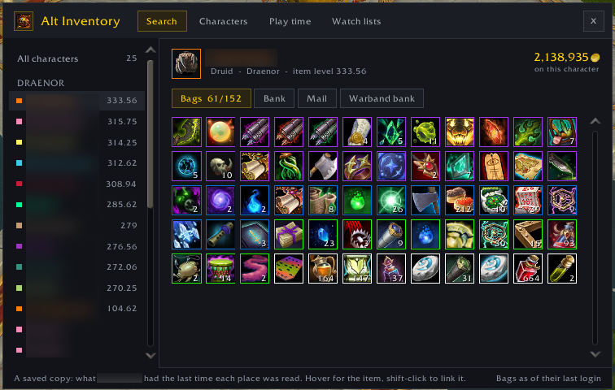
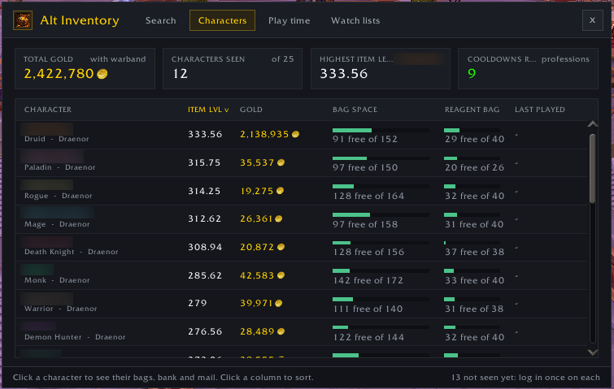

# Alt Inventory

A lightweight World of Warcraft addon that shows, in an item's tooltip, how many of that item each of your alts is holding, broken down by Bags, Character Bank, Mail and Warband Bank. Its window (redesigned in 2.0) searches every character at once, shows any character's bags without logging in, and has tabs for your characters, play time and watch lists.

**New here?** The [wiki](wiki/Home.md) explains every feature step by step (also on the [website](https://ctrlshiftzed.com/wiki/alt-inventory/)). Questions it doesn't answer: ask on [Discord](https://discord.gg/wz7fw6jM9Z).

Built as a minimal alternative to TradeSkillMaster's inventory tooltip, without TSM's memory footprint or crash surface.

- **Version:** 2.0.3
- **Interface versions:** `120105` (Retail), `16001` (WoW Forever), `50504` (Mists Classic), `20506` (Burning Crusade Anniversary), `11509` (Classic Era)

## Game versions

One download runs on every version: Retail, WoW Forever, Mists of Pandaria Classic, Burning Crusade Anniversary and Classic Era (Hardcore and Season of Discovery too). Each version keeps its own saved data, as the game does. On WoW Forever characters are tracked by their full name, first name and surname, so two with the same first name stay apart. On Classic the keyring is counted (Classic Era and Burning Crusade), every currency counts per character, and the Warband Bank only shows where the game has one (Retail and WoW Forever).

## What it does

Mouse over an item and Alt Inventory appends lines to the tooltip listing each character that holds it and where:

```
Alt Inventory              Total: 47
Fatheed                    Bags: 12, Bank: 20
Bankalt                    Bank: 10
Warband Bank               5
```

Four storage locations are tracked: Bags, Character Bank, Mail (items attached to letters) and Warband (account) Bank. No auction house, no vendor pricing, deliberately narrow scope.

It also keeps each character's gold (hover the minimap button for every character's gold, the Warband Bank's and the total) and their currencies that can be transferred between characters: hover one to see how much each character has, or search for it by name with the *Currencies* filter.

## The window

Click the magnifier in your bags' search box or the Alt Inventory button on the minimap (also in the minimap's addon list), or type `/altinv search`.



- **Search:** your characters sit down the left, grouped by realm with their class colour and item level. Type part of an item's name and every match is a card with the total, a bar of who holds most and every holder. Filter by place (bags, bank, mail, warband, currencies), sort by name or most held, and shift-click to link an item in chat. A number searches by item ID, and you can drop an item on the search box.
- **See any character's bags:** click a character on the left to see their bags, bank, mail and the Warband Bank as icon grids, without logging in.
- **Characters** (`/altinv characters`): total gold, characters seen, highest item level and cooldowns ready, then a table you can sort by item level, gold, bag space, reagent bag or last played. Hover a character for concentration, Moxie, profession cooldowns and this patch's currencies.
- **Play time:** how long you've played on each character, and added up by class, role (from each character's current spec) or faction. A character's time is read when you log into it.
- **Watch lists** (`/altinv watch`): built-in lists for Consumables and Trade goods, Lumber on Retail (with your Essence of Lumber on top, `/altinv lumber`), and lists of your own.



Beside the profession window, the reagent finder lists who else holds the materials for the recipe or order on screen (`/altinv reagents` turns it off and on). Shift-drag a panel by its title to move the whole column, and Shift-right-click it to put it back; the spot is remembered.

## How it works

The game only exposes the currently logged-in character's inventory, so:

- A character's data only exists after they've logged in with the addon installed.
- Bank and Warband Bank counts only update once that bank UI has been opened at least once on that character, and Mail once the mailbox has been opened.
- Warband Bank is account-wide and stored once, shown as a single line.

This is a hard API limitation, not a design choice, it's the same reason Altoholic, DataStore, and TSM all require you to visit each alt.

Data is written to a `SavedVariables` table (`AltInventoryDB`) on logout and loaded by every character on login. That's the mechanism by which one character "sees" another's items.

Bank, Mail and Warband Bank counts more than a day old show their age in the tooltip, for example `Bank: 20 (12d ago)`, so you know when a count may be out of date.

Mail with items or gold that expires within 3 days gets a warning when you log in, on any character, so nothing gets sent back or deleted. Tooltips show it too, for example `Mail: 3 (expires in 1d 4h)`.

## Commands

- `/altinv`, rescan now and list every tracked character with their gold and when their bank and mailbox were last opened.
- `/altinv search`, open the window. `/altinv find potion` opens it searching for "potion".
- `/altinv characters`, open the Characters tab.
- `/altinv watch`, open your watch lists.
- `/altinv remove Name` (or `Name-Realm`), forget a deleted, renamed or transferred character.
- `/altinv minimap`, show or hide the minimap button.
- `/altinv mail`, list mail with items or gold expiring in the next 3 days. `/altinv mailwarn` turns the login warning off or on.
- `/altinv lumber`, open the Lumber watch list (Retail): every lumber type and Essence of Lumber on every character.
- `/altinv reagents`, turn the reagent finder off or on.
- `/altinv debug`, print what the addon sees (versions, your character's name and realm, what's saved, any error at login) to paste into a bug report.

## Installation

1. Copy the `altinventory` folder into your WoW `Interface/AddOns/` directory.
2. Make sure the folder is named `AltInventory` (matching the `.toc` file name) if your AddOns folder expects that.
3. Restart WoW or reload UI (`/reload`).
4. Log in on each alt at least once, and open their bank (and Warband Bank) at least once, to populate their data.

## Files

- `AltInventory.toc`, addon metadata, interface version, saved variables declaration.
- `Core.lua`, saved-variable storage and scanning (bags, bank, mail, warband, item names).
- `Tooltip.lua`, the tooltip lines.
- `Search.lua`, finding items by name.
- `Characters.lua`, `Played.lua`, per-character details and play time.
- `UI/Skin.lua`, the window's colours, panels, buttons and lists.
- `UI/SearchWindow.lua`, the window: title bar, tabs, status line, and the bag search button.
- `UI/Pages/`, one file per tab: Search (with the bag viewer), Characters, Played and Watch.
- `UI/MinimapButton.lua`, the minimap button and the addon list entry.
- `AltInventory.lua`, events and the slash command.
- `icon.tga`, addon icon shown in the in-game AddOn List.

## License

MIT, see [LICENSE](LICENSE).
